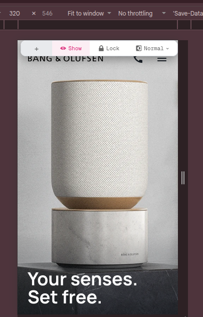
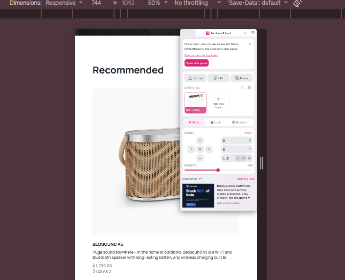
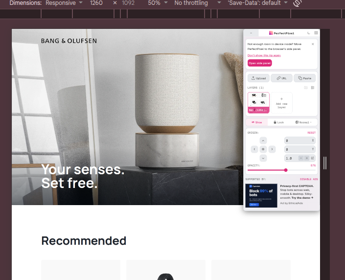
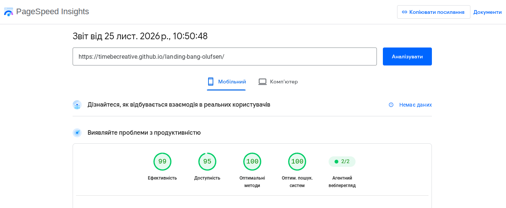
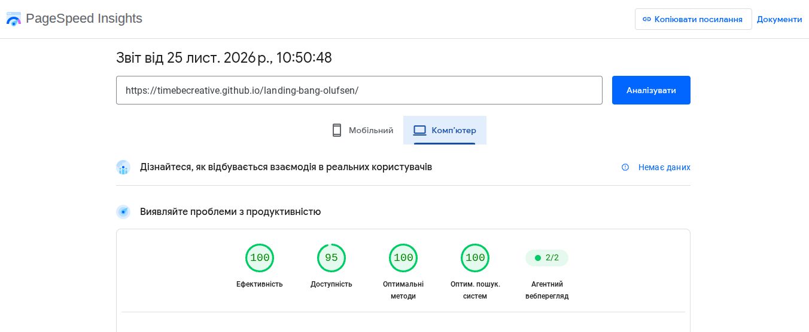

# Лабораторна робота №10. Адаптивний лендінг Bang & Olufsen

Фінальний проєкт курсу «Веб-технології»: адаптивний лендінг за макетом Figma без використання клієнтського JavaScript.

* **Варіант:** №1 (студентка №16) — макет **Bang & Olufsen** (`v2 B&O`), методологія **BEM + SMACSS**
* **Макет Figma:** [Bang & Olufsen (`v2 B&O`)](https://www.figma.com/design/xIVUXiPZ3hdpEFiIC0qbTL/BOSE-New-Version?node-id=6817-432&t=tAUceb5DWq1YiU9g-0)
* **Демо (GitHub Pages):** [https://timebecreative.github.io/landing-bang-olufsen/](https://timebecreative.github.io/landing-bang-olufsen/)

---

## Команди запуску та розробки

| Команда           | Опис дії                                                                              |
| :---------------- | :------------------------------------------------------------------------------------ |
| `npm install`     | Встановлення всіх необхідних залежностей проєкту                                      |
| `npm run dev`     | Запуск локального сервера розробки Vite з гарячим оновленням (HMR)                    |
| `npm run build`   | Продакшн-збірка проєкту (компіляція Pug, SCSS, мінімізація у папку `dist`)            |
| `npm run preview` | Локальний попередній перегляд зібраної продакшн-версії з папки `dist`                 |
| `npm run format`  | Автоматичне форматування всіх файлів проєкту за допомогою Prettier                    |
| `npm run lint`    | Запуск повної перевірки стилів (Stylelint) та форматування (Prettier)                 |
| `npm run images`  | Генерація оптимізованих зображень у форматах `AVIF`, `WebP` та `JPG` (`400w`, `800w`) |

---

## Декомпозиція сторінки на BEM-блоки

Розмітка реалізована на **Pug** із використанням базового шаблону (`layouts/main.pug`), секційних включень (`includes/`), міксину іконок (`mixins/icon.pug`) та винесенням контенту у структурований файл даних (`data/site.pug`).

* **Layout (`l-`):** `l-container`, `l-grid` (`--debug`), `l-header` (`__inner`, `__logo`, `__actions`).
* **State (`is-`):** `is-visually-hidden`.

| Блок            | Елементи                                                              | Модифікатори | Примітка                                                                |
| :-------------- | :-------------------------------------------------------------------- | :----------- | :---------------------------------------------------------------------- |
| `logo`          | `__img`                                                               | —            | Логотип бренду у шапці та меню                                          |
| `icon-button`   | `__icon`                                                              | —            | Інтерактивна кнопка-іконка зі станами `:hover` та `:active`             |
| `phone-link`    | `__number`                                                            | —            | Посилання `tel:`, на десктопі при наведенні плавно відкриває номер      |
| `burger`        | `__lines`, `__line`                                                   | —            | Іконка меню, довжина ліній змінюється на `:hover` чистим CSS            |
| `menu`          | `__inner`, `__top`, `__nav`, `__contacts`, `__phone`, `__call-link`   | —            | Повноекранний оверлей, відкривається/закривається без JS через `:target` |
| `nav`           | `__list`, `__item`, `__link`                                          | —            | Навігаційний список усередині меню (мікс `menu__nav`)                   |
| `hero`          | `__media`, `__img`, `__container`, `__title`                          | —            | Повноширинний перший екран (`<picture>`, `fetchpriority="high"`)        |
| `section-title` | —                                                                     | —            | Уніфікований заголовок секцій сторінки                                  |
| `recommended`   | `__title`, `__list`, `__item`                                         | —            | Секція рекомендованих товарів (`__item` міксується з `product-card`)    |
| `product-card`  | `__media`, `__img`, `__title`, `__description`, `__price`             | —            | Картка товару зі співвідношенням сторін `1:1` та фоном `#F9F9F9`        |
| `categories`    | `__title`, `__list`, `__item`, `__footer`, `__button`                 | —            | Секція категорій (`__button` міксується з `button`)                     |
| `category`      | `__media`, `__photo`, `__img`, `__title`                              | —            | Парна сітка зображень категорії (`1+1` / `3+3` / `6+6` колонок)         |
| `button`        | —                                                                     | `--dark`     | Кнопка зі станами default / `:hover` / `:active` / `:focus-visible`     |
| `about`         | `__media`, `__img`, `__body`, `__title`, `__text`                     | —            | Банер та двоколонковий блок опису бренду на фоні `#FCFAEF`              |
| `contacts`      | `__title`, `__form`, `__info`, `__group`, `__label`, `__value`        | —            | Секція контактів із формою та активними посиланнями `tel:` / `mailto:`  |
| `contact-form`  | `__submit`                                                            | —            | Форма зворотного зв'язку (`__submit` міксується з `button`)             |
| `field`         | `__control`                                                           | `--textarea` | Поле вводу зі станами default / `:hover` / `:focus-visible` / `:user-invalid` |

---

## Архітектура стилів (BEM + SMACSS)

Організація SCSS побудована за поєднанням методології іменування **BEM** (`block`, `block__element`, `block--modifier`) та категорійної архітектури **SMACSS**:

```text
src/styles/
├── abstracts/      # Дизайн-токени ($colors, $tiers), функція rem(), міксин mq() — не генерують CSS
├── base/           # Підключення локальних шрифтів (@font-face), reset, базові стилі тегів (без класів)
├── layout/         # Структурні каркаси сторінки з префіксом l- (.l-container, .l-grid, .l-header)
├── modules/        # Ізольовані BEM-блоки (один блок = один SCSS-partial)
├── state/          # Глобальні стани та утиліти доступності з префіксом is- (.is-visually-hidden)
├── theme/          # Генерація CSS Custom Properties у :root для кожного брейкпоінта
└── main.scss       # Єдина точка входу, що визначає порядок підключення шарів
```

### Правила та порядок каскаду

1. **Порядок підключення у `main.scss`:** `theme` $\rightarrow$ `base` $\rightarrow$ `layout` $\rightarrow$ `modules` $\rightarrow$ `state`. Спочатку ініціалізуються змінні `:root`, далі скидаються базові стилі елементів (без жодного класу в `base/`), після чого накладаються сітка, компоненти та стани.
2. **Ізоляція блоків:** кожен BEM-блок зберігається в окремому файлі в `modules/`, не використовує селектори за `id`, вкладені теги (`.card h3`) або `!important`, а глибина вкладеності селекторів не перевищує 3 рівнів (контролюється `Stylelint`).
3. **Зовнішня геометрія через мікси:** самі блоки не задають зовнішніх відступів (`margin`) чи позиціонування в сітці — це делегується батьківському блоку через BEM-мікс (наприклад, `class="product-card recommended__item"`).

---

## Модульна сітка

Модульна сітка реалізована як перевикористовуваний layout-блок **`.l-grid`** на основі **CSS Grid** (`grid-template-columns: repeat(var(--grid-columns), minmax(0, 1fr))`) з адаптивними дизайн-токенами та підходом **mobile first** (медіазапити через міксин `@include mq('tablet')` і `@include mq('desktop')`):

| Брейкпоінт / фрейм | Кількість колонок | Ширина колонки | Міжколонковий інтервал (`gutter`) | Зовнішні поля (`margin`) | Максимальна ширина контенту |
| :----------------- | :---------------: | :------------: | :-------------------------------: | :----------------------: | :-------------------------: |
| Mobile (`320px`)   |         2         |    `130px`     |              `20px`               |          `20px`          |           `280px`           |
| Tablet (`744px`)   |         6         |     `80px`     |              `24px`               |          `72px`          |           `600px`           |
| Desktop (`1260px`) |        12         |     `63px`     |              `24px`               |         `120px`          |          `1020px`           |

* Повноширинні секції (`hero`, банер у `about`) розтягуються на `100vw`, тоді як внутрішній контент центрується через `.l-container`.
* Усі елементи всередині сітки прив'язані до колонок через `grid-column` (наприклад, картки `recommended__item` займають `span 4` з 12 колонок на десктопі, а картки `category__photo` — `span 6` з 12).
* Для візуального контролю колонок під час звірки з макетом передбачено модифікатор **`.l-grid--debug`**, який підсвічує колонки через `repeating-linear-gradient`.

---

## Перевірка якості та відповідності макету

### 1. PerfectPixel (320px / 744px / 1260px)

> Збережи 3 скриншоти накладання макета у папку `docs/` та онови шляхи нижче:

* **Mobile (320px):**
  
* **Tablet (744px):**
  
* **Desktop (1260px):**
  

### 2. Валідація HTML (W3C Markup Validation Service)

* Результат перевірки опублікованої сторінки: **0 помилок**.
  

### 3. Продуктивність та доступність (PageSpeed Insights)

* Результати перевірки для **Mobile** та **Desktop** (Performance, Accessibility, Best Practices, SEO — 90–100 балів):
  
  